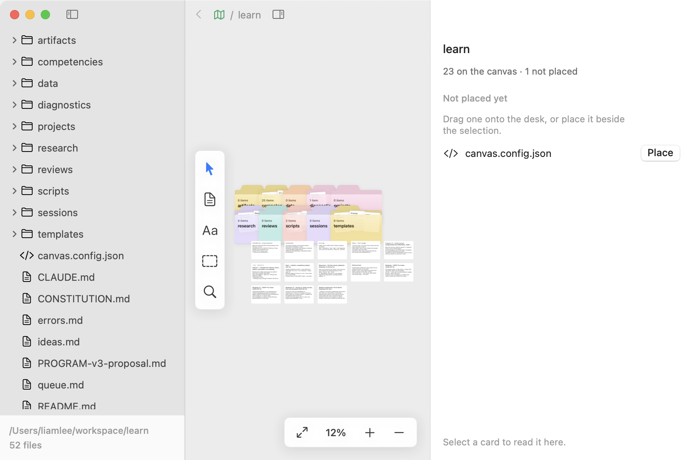
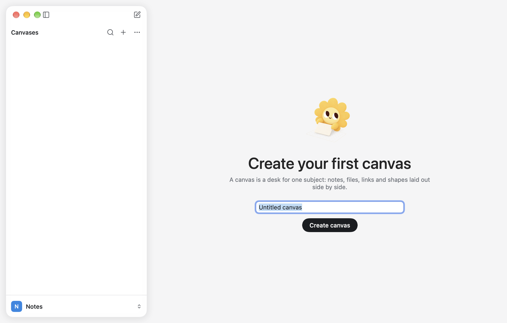
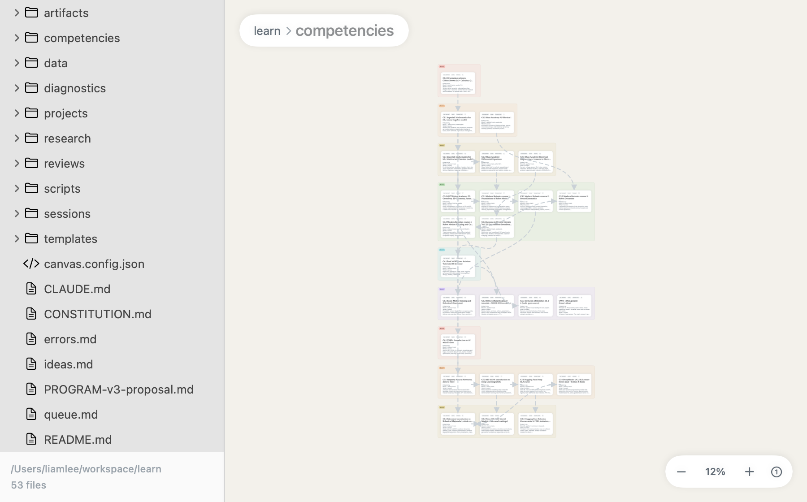
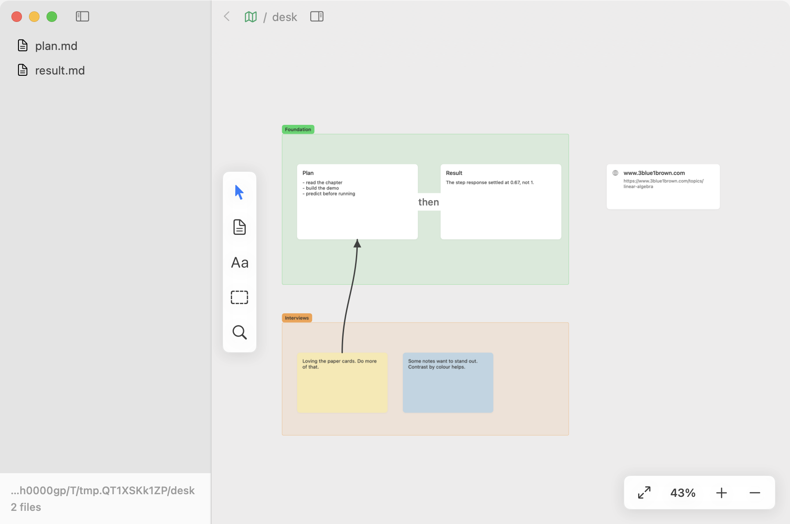
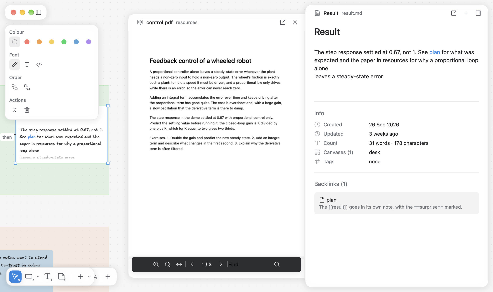
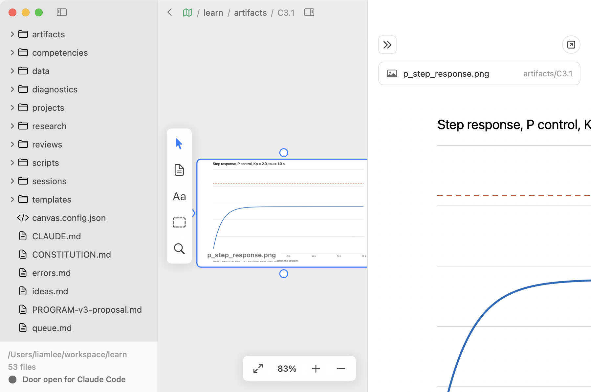

<h1 align="center">Alex</h1>

<p align="center">
  A native macOS canvas over a folder of plain files, with a door for Claude Code.<br>
  Canvases you make, notes as cards, and the files are the only truth.
</p>

<p align="center">
  
  
  
  
  
</p>

---

<p align="center"></p>

## What it is

Point Alex at a folder (a *vault*) and lay its files out on canvases you
make, each a desk for one subject. A folder with no canvas yet opens on
an empty desk that asks for the first one's name. Each file you place is
a card; cards can be moved, grouped, connected and opened in a side
panel, and a file is on a canvas only where you put it. Everything
Alex knows is in the folder: the layout is a `.canvas` file in the open
[JSON Canvas](https://jsoncanvas.org) format, notes are Markdown, images are
images. Git, Obsidian, a text editor and Claude read and write the same
files, and Alex re-renders when any of them do.

<p align="center"></p>

There is no AI inside Alex. Instead it opens a local
[MCP](https://modelcontextprotocol.io) door so Claude Code, working in the
same folder, can see what is on screen, write files into the vault, place
them on a canvas and point at them. The door reads, adds, updates and
focuses. It never deletes.

Alex was built to run a self-taught robotics programme: the coach (Claude)
writes session logs, plots and notes into the repo, and the canvas shows
where things stand. It is generic enough for any folder of notes.

<p align="center"></p>

## Features

**The desk**

- Pan with two fingers, pinch to zoom, ⌘ + scroll to zoom too. Drag the
  desk to marquee-select, ⇧ to add.
- The palette at the desk's foot has one cell per purpose: Select;
  Shapes, a menu of rectangle, ellipse, diamond, line and arrow that wears
  the shape last drawn; Draw, ink by hand, stroke after stroke until you
  put the pen down; Text, bare words where you click or drag; Sticky
  note, one where you next click; then, past
  a hairline, Add, a menu of new note, import files and add a link. A cell
  with a chevron opens a menu, each cell wears its key at the corner, and
  every tooltip says it on a keycap. The keys are V R O D L A P T S until you
  change them in Settings, a letter or a digit each. Pick a shape, drag it
  out on the desk (or click for the default size), and the palette hands
  back to Select. ⇧ while you drag keeps the proportions: a square, a
  circle, a line on a 15° step. An arrow dragged from one card to another is a
  connection; anywhere else it is a shape. A shape is outline or filled,
  solid, dashed or dotted (a box starts dashed), thin, regular or bold, in
  any of four colours, with an arrowhead at either
  end of a line, set in the **style panel** that floats at the desk's
  left while anything is selected, as Excalidraw's does: colour, fill,
  stroke width and style, arrowheads, font, size, corners, order a step
  or all the way (⌘[ ⌘], with ⌥ to the back or front),
  duplicate, fold and remove, each shown when the whole selection takes
  it; double-click one, or select it and press ↩, to write in it, and
  Esc or ⌘↩ to finish with it still selected. A shape is a `text` node with `x-` keys in the `.canvas`
  file, so Obsidian shows a card in its place. Every glyph you can press
  has a tooltip, shown once the pointer has rested on it.
- Cards move by dragging, resize by any edge or corner, ⇧ keeping the
  proportions — a selection wears
  Figma's square at each corner, and the pointer over an edge says so —
  and connect by dragging the dot that comes out of a selected card's
  side as the pointer nears it onto another card. ⌘G groups the selection; dragging a group carries
  what it holds; connections follow while you drag. An empty outline
  takes a press only on its stroke, so cards inside a box stay
  pressable; double-click inside it to write in it. Every action is one
  undo step, and undo takes back only your change, never one the door
  or another app made since.
- A note's card is the note as the panel renders it, at the card's own
  sizes: headings, lists, quotes, rules, code, highlights and links, cut
  and faded where the card ends. Double-click it, or press ↩ with it selected,
  to write on it where it lies, in the same editor, the frontmatter kept out of the way. The
  panel stays the fuller place; both save to the same file, so a note
  open in both settles either way.
- The pointer over a card raises its toolbar, a pill on the card's top
  edge, the way Heptabase's does: the
  chevron folds the card down to its title row (⌘⌥↩) and unfolds it again,
  the panel button adds the file to the side panel (⌥↩), and the arrow
  draws a connection from it. The fold is written into the `.canvas` file
  as the card's height, so it stays folded next time and in any other JSON
  Canvas app. Right-click has the same verbs.
- A PDF is a page-shaped card: its first page drawn at the card's width on
  the desk's grey, with the file's name and its length underneath. It is a
  document, not a cropped thumbnail.
- A link is a card too: a YouTube video, a post on X or Threads, a Pin, a
  reel, a Vimeo, TikTok or Spotify item, or any page. The card shows the
  picture and title the site publishes (a post shows its text); the panel
  plays the video or shows the post or page, live, and any click inside it
  opens your browser. Add one with ⌘L, paste an address over the desk, or
  drag a link out of your browser. Titles and pictures are fetched without
  any key and cached; Settings can turn the fetching off, and a card then
  shows its address.
- Paste a picture over the desk (a screenshot, an image copied from a
  browser) and it is saved beside the canvas as `Pasted image <date>
  <time>.png` and placed mid-view in its own shape. A file copied in Finder
  pastes as if dropped.
- ⌘C, ⌘X and ⌘V work on the desk: a sticky, a text box, a shape, a link,
  a section with what it holds, or a picture, with the arrows between them.
  A paste lands a step down and right, or mid-view on another canvas; a
  picture already there is copied to a file of its own, and a note's card
  is not doubled, since a file has one card on a canvas.
- Copy in Excalidraw and paste on the desk: its rectangles, ellipses,
  diamonds, text, arrows (connectors when both ends are pasted too),
  lines, freehand strokes and pictures become Alex's own, editable, their
  colours snapped to Alex's four.
- A card taken off a canvas stays in the vault: ⌘K opens it again, and
  **Place on canvas** or the canvas menu's **Place everything not yet
  placed** brings it back.
- A card's file opens in the panel: Markdown renders in place and edits in
  place (headings without the `#`, lists that behave, checklists you tick,
  pasted images stored beside the note), PDFs in PDFKit, HTML in a web view
  that can read only the vault, code in mono. Notes save themselves a moment
  after you stop typing, and if the file changed on disk while you were
  editing, the panel says so and asks, rather than overwriting either side.
- A note's frontmatter folds to one quiet **Properties** row above it,
  with its count; press it or its chevron to unfold the block as text to
  edit. The body and the block write the one file. Cards show no
  frontmatter at all: a title and the first lines.

**Views from frontmatter** (`canvas.config.json` in the vault, optional)

- `colorBy`: a frontmatter key whose value tints the card
  (`status: done` → green, with a value-to-colour map you write).
- `edgesFrom`: a key whose values are ids of other notes; Alex draws dashed
  edges to them. Prerequisites become arrows.
- `groupBy`: a key to arrange a directory into labelled groups
  (⌘⇧A, "Arrange by frontmatter"). Nine course blocks become nine bands.

**Reading**

- A PDF opens in the panel with its own reader: zoom, fit to width, page
  by page, find. Select text and a row appears: seven highlighter colours,
  copy, and **Quote onto the desk**, which puts the passage on the canvas
  as a card linked back to the page. Highlights are written into the PDF
  itself, so Preview and git see them.
- Notes link to each other with `[[name]]`: the link is in the accent, a click opens
  the note (and creates it if it does not exist), and the note's panel
  lists its **Backlinks** with the line that linked. `==text==` is a
  highlight. Select words in a note, a sticky or a text box and a format
  bar floats over them, as in Notion: turn the line into a heading, list, checklist or quote, or
  make the words bold, italic, underlined, ~~struck~~, code, highlighted
  or a note link (⌘B, ⌘I, ⌘U, ⌘⇧X, ⌘E, ⌘⇧H). A sticky's, a text box's
  or a shape's words take one of four sizes, Small to Extra large, and one
  of three faces: Excalidraw's hand-drawn Excalifont (the desk's default,
  notes' cards included), Normal or Code, set left,
  centred or right. The slash menu adds tables, maths blocks, inline maths,
  dates, times and note links to Donna's headings, lists, checklists,
  quotes, code and images.
- Under every note, an **Info** block: created, updated, word and
  character counts, the canvases it appears on, its tags.
- The panel is a sheet floating at the desk's right: `+` keeps the
  current one open as a sub-sheet drawn out of its edge and starts
  another, so a PDF can sit beside the note you are writing. It closes
  when nothing is selected and no pin holds it. A card on several canvases
  shows **Appears in N canvases** above it, with a jump to each.

**Finding things**

- The sidebar is Figma's, a card floating over the desk's left that
  holds all the window's chrome, the traffic lights included: a head
  row, then **Canvases** — every canvas, with find, a new canvas and the
  canvas's `•••` — and the workspace at the foot. Double-click a canvas's
  row, or pick **Rename** from its right-click menu or the `•••`, to
  rename it (the `.canvas` file is renamed); press a canvas's icon, or
  pick **Icon and colour…**, to choose its glyph and one of six
  colours, kept in the file as `x-icon` and `x-color`. There
  is no file tree: the desk is where files are, and ⌘K finds any of
  them. The toggle beside the traffic lights, or ⌘\, folds the sidebar
  into its head — the lights and the toggle, nothing else, the way
  Excalidraw's menu folds into one button — and the desk is clean; drag
  the card's edge to make it wider.
- ⌘F finds text on the open canvas, as Excalidraw's search does: every
  hit listed in the panel under its card, the cards ringed on the desk,
  Enter stepping from one to the next.
- ⌘K finds a file by path or title and pans to its card. A file with no
  card on the open canvas opens in the panel anyway, with **Place on
  canvas** to put it there.
- Every vault you open is a **workspace**, listed in the menu under the
  workspace's row at the sidebar's foot. Pick one, press ⌥⌘← or ⌥⌘→, or
  swipe two fingers across the sidebar, and the sidebar slides to that
  vault the way Arc slides between spaces. The same menu makes a new
  workspace (**New workspace…**: type a name, and a folder of that name
  appears beside the open one, empty but for the `.mcp.json` that
  connects the door),
  takes one off the list with the × at its row's end (nothing on disk
  changes) and opens Settings (⌘,), a sheet over the desk; a folder you
  already have opens with ⌘O.
  The row shows the vault's initial, or the
  [Lucide](https://lucide.dev/icons) icon named by a top-level `"icon"` in
  its `canvas.config.json` (`"icon": "lamp-desk"`).
- Right-click any card or section for the panel, Finder,
  or removal. The section label's `•••` opens the
  same menu. The palette's Add menu copies files from outside the vault
  into the vault; a file dropped on the desk from Finder is copied in
  beside the canvas.
- **Connecting blocks**, as in FigJam and Excalidraw: select a card, sticky
  or shape, bring the pointer to one of its sides for its dot and drag that
  onto another, or draw an
  Arrow (A) or a Line (L) from one block to another. The block an end will
  attach to is ringed while you draw; an end within a few points of a
  block counts. A connection follows its blocks when they move. An arrow
  ending on empty desk stays a drawn shape, and holding ⌘ keeps it one
  wherever it ends.

<p align="center"></p>

<p align="center"></p>

## Claude Code and the door

Turn on **Settings → Claude Code → Serve this vault to agents on this Mac**.
Alex listens on `http://127.0.0.1:53276/mcp`, loopback only, and Settings
shows whether it is actually serving. Then either:

- click **Write .mcp.json into the vault**, so anyone who opens the vault in
  Claude Code is asked once to trust the `alex` server and is connected; or
- run `claude mcp add --transport http alex http://127.0.0.1:53276/mcp` to
  register it for this Mac only.

Eight tools, all thin wrappers over the file format:

| Tool | Does |
|---|---|
| `get_context` | The vault root, the open directory and canvas, the selected cards with their file paths or text, the viewport, the unplaced files |
| `read_canvas` | A canvas as JSON Canvas 1.0 |
| `add_card` | A sticky note, a file card or a link, placed beside a node or the selection if no coordinates are given |
| `write_artifact` | A file into the vault (text or base64), directories created, placed as a card on the open canvas (or the one named); refuses to overwrite without `overwrite: true` |
| `connect` | An edge, with an optional label |
| `update_card` | Text, colour, label, position, size |
| `focus` | Opens a canvas in the app and pans to a node |
| `list_files` | Paths under a directory, with a glob |

A session in the robotics vault ends with the coach writing the artifacts
through `write_artifact`, so a new plot lands in the right folder and on
the open canvas, and calling `focus`, so the app pans to it.

<p align="center"></p>

Everything the door can do, Claude can also do by writing files directly,
because the watcher renders whatever changes. The door adds what files
cannot: knowing what you are looking at, placing without layout maths, and
pointing.

## Install

macOS 15 (Sequoia) or later. Download `Alex.dmg` from the
[releases](https://github.com/liamlee2110/alex/releases), or build from
source with Xcode 16 or later:

```bash
git clone https://github.com/liamlee2110/alex.git
cd alex
./build.sh && open Alex.app
```

The build is a universal binary, ad-hoc signed. A downloaded build shows a
Gatekeeper warning on first open: right-click, Open. Copy `Alex.app` to
`/Applications` to keep it. There are no third-party dependencies.

To open a vault without the picker:

```bash
open Alex.app --args --vault ~/path/to/vault
```

That is a visit: the vault is open for that launch only and does not join
the workspaces at the sidebar's foot until you open it from there.

## Starting a vault

Any folder works. [`vault-template/`](vault-template/) is a starter with a
`CLAUDE.md` that tells Claude Code how the vault is shaped, the `.mcp.json`
that connects the door, and an example `canvas.config.json`.
Copy it, `git init`, open it in Alex and in Claude Code.

Alex writes into a vault only these things: the `.canvas` files you
make and rename, images pasted into notes (beside the note) or onto a
canvas (beside the canvas, as `Pasted image <date> <time>.png`), and
files you or the door create on purpose. Nothing else. The `.canvas`
files are worth committing: they are the map.

## Keyboard

| | |
|---|---|
| ⌘K | Find in vault |
| ⌘F | Find text on the canvas (↩ next, ⇧↩ previous, esc closes) |
| ⌘N / ⌘⇧N | New note / new sticky note |
| ⌘G | Group selection |
| ↩ / esc or ⌘↩ | Write in the selected box / finish |
| ⌘A | Select everything on the canvas |
| ⌘D | Duplicate the selection |
| ⌘⌥] / ⌘⌥[ | Bring to front / send to back |
| ← → ↑ ↓ | Nudge the selection a point, five with ⇧ |
| ⇧2 | Zoom to the selection |
| V, R, O, D, L, A, T | Select, rectangle, ellipse, diamond, line, arrow and sticky note tools, on the desk |
| ⇧ while drawing or resizing | Keep the proportions: a square, a circle, a line on a 15° step |
| ⇧ while dragging | Move along one axis |
| ⌥ while dragging / resizing | Leave a copy behind / resize about the centre |
| ⌥↩ | Add to the side panel |
| ⌘⌥↩ | Fold or unfold the selected cards |
| ⌘⌫ or ⌫ | Remove from canvas (the file stays) |
| ⌘⇧A | Arrange by frontmatter |
| ⌘= ⌘- ⌘0 ⌘1 | Zoom in, out, actual size, fit |
| ⌘⌥I | Show or hide the panel |
| ⌘O | Open another vault |
| ⌘Z / ⌘⇧Z | Undo / redo |

## How it is built

SwiftUI and AppKit, one Swift package, no Xcode project, no dependencies.
The Markdown editor, the MCP transport, the window plumbing and the design
law come from [Donna](https://github.com/liamlee2110/donna), the same
author's menu bar app. The shape of the desk follows Heptabase's whiteboard,
measured from its screenshots: borderless white cards with a 2pt
selection, sections as tinted regions with a solid label pill on the top
edge, near-black arrows and a wide panel. The shell is Figma's: one white
sidebar floating over the desk's left holding the traffic lights, the
canvases and the workspace, which folds into its head row; no top bar
and nothing above it; a
dotted desk of warm white, the faintest trace of the logo's yellow, running the window's height with white cards on
it, the palette at its foot, and the detail sheet floating at its right. The colours are white and
neutral grey with black type, and one blue for selection, links, the
caret, the door and the tool in hand. The chrome says three things in
three shapes: where you are is a grey square, the tool in hand and the
workspace's mark a solid blue one, and a button a capsule.
The plan, every decision and its reasons, and the milestones are in
[PLAN.md](PLAN.md); the rules and the sharp edges are in
[CLAUDE.md](CLAUDE.md); how to work on it is in
[CONTRIBUTING.md](CONTRIBUTING.md).

Not yet: LaTeX rendering (maths shows as typed), Windows and Linux (by
design), sync of any kind (git is the sync).

## Licence

MIT. See [LICENSE](LICENSE).
