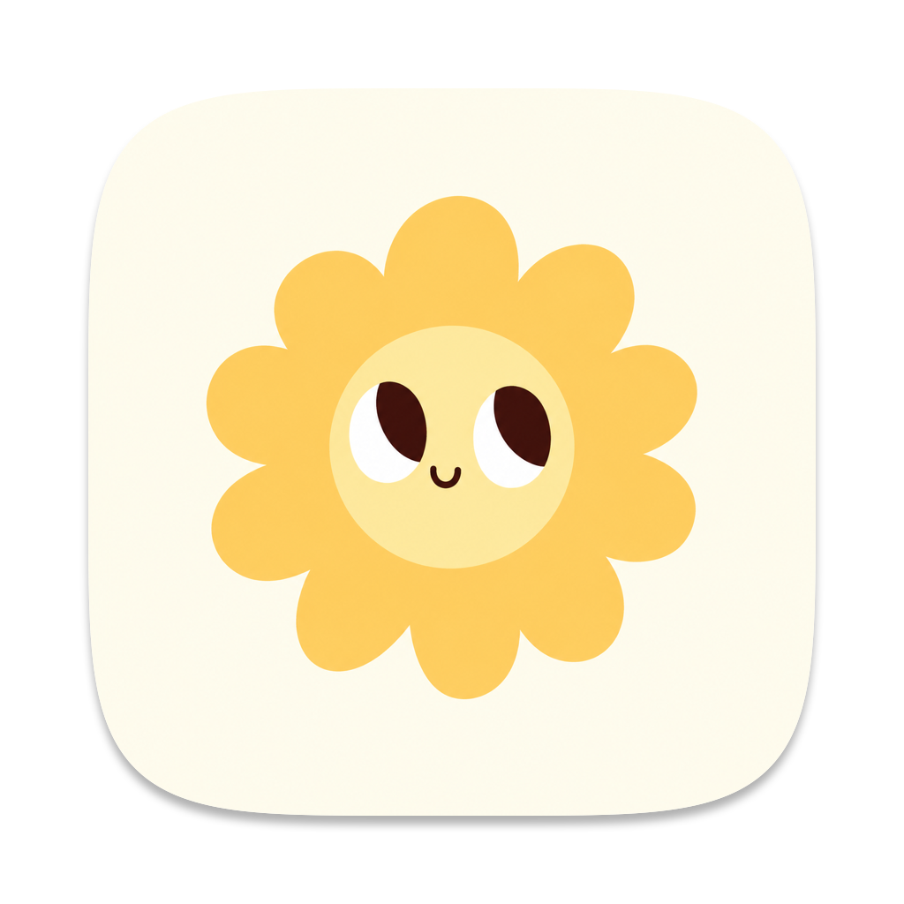

<p align="center"></p>

<h1 align="center">Alex</h1>

<p align="center">
  A native macOS canvas over a folder of plain files, with a door for Claude Code.<br>
  Canvases you make, notes as cards, and the files are the only truth.
</p>

<p align="center">
  <a href="https://github.com/liamlee2110/alex/actions/workflows/ci.yml"></a>
  <a href="https://github.com/liamlee2110/alex/releases"></a>
  
  
  
  
  <a href="LICENSE"></a>
</p>

<p align="center">
  <a href="#install">Install</a> ·
  <a href="#quick-start">Quick start</a> ·
  <a href="#features">Features</a> ·
  <a href="#claude-code-and-the-door">Claude Code</a> ·
  <a href="#keyboard">Keyboard</a> ·
  <a href="#contributing">Contributing</a>
</p>

---

<p align="center"></p>

## What it is

Point Alex at a folder (a *vault*) and lay its files out on canvases you
make, each a desk for one subject. Each file you place is a card; cards
can be moved, grouped, connected and opened in a side panel, and a file
is on a canvas only where you put it.

Everything Alex knows is in the folder. The layout is a `.canvas` file in
the open [JSON Canvas](https://jsoncanvas.org) format, notes are Markdown,
images are images. Git, Obsidian, a text editor and Claude read and write
the same files, and Alex re-renders when any of them do.

There is no AI inside Alex. Instead it opens a local
[MCP](https://modelcontextprotocol.io) door so Claude Code, working in the
same folder, can see what is on screen, write files into the vault, place
them on a canvas and point at them. The door reads, adds, updates and
focuses. It never deletes.

Alex was built to run a self-taught robotics programme: the coach (Claude)
writes session logs, plots and notes into the repo, and the canvas shows
where things stand. It is generic enough for any folder of notes.

**What it promises**

- **Your files, in open formats.** No database, no cache that outlives a
  second, no export step. Delete Alex and every note, picture and layout
  is still in the folder, readable by anything.
- **No account, no cloud, no telemetry.** The only traffic Alex starts is
  fetching titles and pictures for link cards, a daily look at the
  latest version (Settings turns each off) and the pages you open in the
  panel. Git is the sync.
- **Native and small.** SwiftUI and AppKit, one Swift package, one
  dependency: Sparkle, for updates.

<p align="center"></p>

## Install

macOS 15 (Sequoia) or later, Apple silicon or Intel.

**Download.** Get
[`Alex.dmg`](https://liamle.me/alex/download),
open it and drag Alex to Applications. It is signed and notarised. Alex
checks for a new version once a day and asks before installing it;
**Alex → Check for updates…** checks now, and Settings turns the daily
check off.

**Build from source** with Xcode 16 or later (or its command line tools);
there is nothing else to install:

```bash
git clone https://github.com/liamlee2110/alex.git
cd alex
./build.sh && open Alex.app
```

`build.sh` makes a universal release build and assembles it into
`Alex.app`. Copy that to `/Applications` to keep it. A build of your own is ad-hoc
signed and does not update itself.

## Quick start

1. Open Alex and pick a folder, any folder of notes. Or copy
   [`vault-template/`](vault-template/), a starter with a `CLAUDE.md` that
   tells Claude Code how the vault is shaped, the `.mcp.json` that
   connects the door and an example `canvas.config.json`, and `git init`
   it.
2. A folder with no canvas yet opens on an empty desk that asks for the
   first canvas's name.
3. Drop files on the desk, or use the palette's **Add** menu. ⌘N makes a
   new note, ⌘L adds a link, ⌘K finds any file in the vault.
4. To let Claude Code in, turn on the door (below) and open the same
   folder in Claude Code.

<p align="center"></p>

To open a vault from the command line without the picker:

```bash
open Alex.app --args --vault ~/path/to/vault
```

That is a visit: the vault is open for that launch only and does not join
the workspaces at the sidebar's foot until you open it from there.

## Features

### The desk

- Pan with two fingers, pinch to zoom, ⌘ or ⌃ + scroll to zoom too. Drag the
  desk to marquee-select, ⇧ to add.
- **The palette** at the desk's foot has one cell per purpose: Select;
  Shapes, a menu of rectangle, ellipse, diamond, line and arrow that wears
  the shape last drawn; Draw, ink by hand, stroke after stroke until you
  put the pen down; Text, bare words where you click or drag; Sticky
  note, one where you next click; then, past a hairline, Add, a menu of
  new note, import files, add a link and add an icon — any of Lucide's
  icons, searched by name, as a mark on the desk. A cell with a chevron opens a
  menu, each cell wears its key at the corner, and every tooltip says it
  on a keycap. The keys are V R O D L A P T S until you change them in
  Settings, a letter or a digit each.
- **Shapes.** Pick one, drag it out on the desk (or click for the default
  size), and the palette hands back to Select. ⇧ while you drag keeps the
  proportions: a square, a circle, a line on a 15° step. An arrow dragged
  from one card to another is a connection; anywhere else it is a shape.
  A shape is a `text` node with `x-` keys in the `.canvas` file, so
  Obsidian shows a card in its place.
- **The style panel** floats at the desk's left while anything is
  selected, as Excalidraw's does: colour (any of four), fill, stroke
  width (thin, regular, bold) and style (solid, dashed, dotted; a box
  starts dashed), arrowheads at either end of a line, font, size,
  corners, order a step or all the way (⌘[ ⌘], with ⌥ to the back or
  front), duplicate, fold and remove, each shown when the whole selection
  takes it. Double-click a shape, or select it and press ↩, to write in
  it, and Esc or ⌘↩ to finish with it still selected.
- **Connections.** Select a card, sticky or shape, bring the pointer to
  one of its sides for its dot and drag that onto another, or draw an
  Arrow (A) or a Line (L) from one block to another, as in FigJam and
  Excalidraw. The block an end will attach to is ringed while you draw;
  an end within a few points of a block counts. A connection follows its
  blocks when they move; an arrow ending on empty desk stays a drawn
  shape, and holding ⌘ keeps it one wherever it ends. Click a
  connection's line to pick it: the panel gives it a colour, a width,
  solid, dashed or dotted, a curved, straight or elbow route and its
  arrowheads, and ⌫ removes it.
- **Cards** move by dragging, resize by any edge or corner (⇧ keeps the
  proportions; a selection wears Figma's square at each corner, and the
  size shows under it while you drag); a picture resizes by its corners,
  keeping its proportions unless ⇧ is held. ⌘G
  groups the selection into a section. Dragging a section carries what it
  holds; connections follow while you drag. An empty outline takes a
  press only on its stroke, so cards inside a box stay pressable.
- **Undo** is per action, and takes back only your change, never one the
  door or another app made since.
- The pointer over a card raises its toolbar, a pill on the card's top
  edge, the way Heptabase's does: fold the card down to its title row
  (⌘⌥↩), add the file to the side panel (⌥↩), or draw a connection from
  it. The fold is written into the `.canvas` file as the card's height,
  so it stays folded next time and in any other JSON Canvas app.
  Right-click has the same verbs. Every glyph you can press has a
  tooltip, shown once the pointer has rested on it.

### Cards for every kind of file

- **Notes.** A note's card is the note as the panel renders it, at the
  card's own sizes: headings, lists, quotes, rules, code, highlights and
  links, cut and faded where the card ends. Double-click it, or press ↩
  with it selected, to write on it where it lies, in the same editor, the
  frontmatter kept out of the way. Both the card and the panel save to the
  same file, so a note open in both settles either way.
- **PDFs** are page-shaped cards: the first page drawn at the card's
  width, with the file's name and its length underneath.
- **Office files.** Word, PowerPoint and Excel, Pages, Keynote and
  Numbers: the first page or slide as QuickLook draws it, a deck on a
  slide-shaped card, with the slide, page or sheet count where the file
  says it.
- **Links.** A YouTube video, a post on X or Threads, a Pin, a reel, a
  Vimeo, TikTok or Spotify item, or any page. The card shows the picture
  and title the site publishes (a post shows its text); the panel plays
  the video or shows the post or page, live, and any click inside it opens
  your browser. Add one with ⌘L, paste an address over the desk, or drag
  a link out of your browser. Titles and pictures are fetched without any
  key and cached; with fetching off in Settings, a card shows its address.
- **Pictures.** Paste one over the desk (a screenshot, an image copied
  from a browser) and it is saved beside the canvas as `Pasted image
  <date> <time>.png` and placed mid-view. A file copied in Finder pastes
  as if dropped; a file dropped on the desk from Finder is copied in
  beside the canvas.
- **Copy and paste.** ⌘C, ⌘X and ⌘V work on stickies, text boxes,
  shapes, links, sections with what they hold, and pictures, with the
  arrows between them. A paste lands a step down and right, or mid-view
  on another canvas; a note's card is not doubled, since a file has one
  card on a canvas.
- **From Excalidraw.** Copy in Excalidraw and paste on the desk: its
  rectangles, ellipses, diamonds, text, arrows (connectors when both ends
  are pasted too), lines, freehand strokes and pictures become Alex's own,
  editable, their colours snapped to Alex's four.
- A card taken off a canvas stays in the vault: ⌘K opens it again, and
  **Place on canvas** or the canvas menu's **Place everything not yet
  placed** brings it back.

<p align="center"></p>

### Reading and writing

- **The panel** is a sheet floating at the desk's right. A card's file
  opens there: Markdown renders and edits in place (headings without the
  `#`, lists that behave, checklists you tick, pasted images stored beside
  the note), PDFs in PDFKit, HTML in a web view that can read only the
  vault, code in mono. `+` keeps the current sheet open as a sub-sheet
  drawn out of its edge and starts another, so a PDF can sit beside the
  note you are writing. A card on several canvases shows **Appears in N
  canvases** above it, with a jump to each.
- **Saving** happens a moment after you stop typing. If the file changed
  on disk while you were editing, the panel says so and asks, rather than
  overwriting either side.
- **Frontmatter** folds to one quiet **Properties** row above the note,
  with its count; unfold it to edit the block as text. Cards show no
  frontmatter at all: a title and the first lines.
- **Note links.** `[[name]]` links are in the accent; a click opens the
  note (and creates it if it does not exist), and the note's panel lists
  its **Backlinks** with the line that linked. `==text==` is a highlight.
- **Formatting.** Select words in a note, a sticky or a text box and a
  format bar floats over them, as in Notion: turn the line into a heading,
  list, checklist or quote, or make the words bold, italic, underlined,
  ~~struck~~, code, highlighted or a note link (⌘B, ⌘I, ⌘U, ⌘⇧X, ⌘E,
  ⌘⇧H). The slash menu adds headings, lists, checklists, quotes, code,
  images, tables, maths blocks, inline maths, dates, times and note links.
- **Type on the desk.** A sticky's, a text box's or a shape's words take
  one of four sizes, Small to Extra large, and one of three faces:
  Excalidraw's hand-drawn Excalifont (the desk's default, notes' cards
  included), Normal or Code, set left, centred or right.
- **The PDF reader**: zoom, fit to width, page by page, find. Select text
  and a row appears: seven highlighter colours, copy, and **Quote onto
  the desk**, which puts the passage on the canvas as a card linked back
  to the page. Highlights are written into the PDF itself, so Preview and
  git see them.
- Under every note, an **Info** block: created, updated, word and
  character counts, the canvases it appears on, its tags.

<p align="center"></p>

### Finding things

- **The sidebar** is Figma's: a card floating over the desk's left that
  holds all the window's chrome, the traffic lights included. Under its
  head row, **Canvases** lists every canvas, with find, a new canvas and
  each canvas's `•••`. Double-click a row, or pick **Rename**, to rename
  the `.canvas` file; press a canvas's icon, or pick **Icon and colour…**,
  to choose its glyph and one of six colours, kept in the file as `x-icon`
  and `x-color`; pick **Delete** to move the `.canvas` file to the Trash,
  where Finder's Put Back is the undo (the files its cards show stay where
  they are). The toggle beside the traffic lights, or ⌘\, folds the
  sidebar into its head and leaves the desk clean; drag its edge to make
  it wider.
- There is no file tree: the desk is where files are. **⌘K** finds a file
  by path or title and pans to its card; a file with no card on the open
  canvas opens in the panel anyway, with **Place on canvas** to put it
  there.
- **⌘F** finds text on the open canvas, as Excalidraw's search does:
  every hit listed in the panel under its card, the cards ringed on the
  desk, ↩ stepping from one to the next.
- **Workspaces.** Every vault you open is a workspace, listed in the menu
  under the workspace's row at the sidebar's foot. Pick one, press ⌥⌘← or
  ⌥⌘→, or swipe two fingers across the sidebar, and the sidebar slides to
  that vault the way Arc slides between spaces. **New workspace…** makes a
  folder of that name beside the open one, empty but for the `.mcp.json`
  that connects the door; the × at a row's end takes it off the list
  (nothing on disk changes); ⌘O opens a folder you already have. The row
  shows the vault's initial, or the [Lucide](https://lucide.dev/icons)
  icon named by a top-level `"icon"` in its `canvas.config.json`
  (`"icon": "lamp-desk"`).

### Quick sketch

⌃⇧Space, from any app, brings up a floating bare desk for a quick
drawing: the palette folded into one small glyph in the corner, a tab at
the window's top to switch canvases or start a new one (⌘N makes
`Sketches/Sketch <date> <time>.canvas`, an ordinary canvas the sidebar
lists like any other). Hold the tab anywhere but its name to move the
window (the grip at its right says so), take its edges to resize it, and
zoom with a pinch or ⌘= ⌘- ⌘0 ⌘1 as on the desk. Esc, or the key again, puts it away and gives the
Mac back to the app you were in; there is nothing to save. The key can
be changed or turned off in Settings.

### Views from frontmatter

An optional `canvas.config.json` in the vault turns frontmatter into
views:

- `colorBy`: a frontmatter key whose value tints the card
  (`status: done` → green, with a value-to-colour map you write).
- `edgesFrom`: a key whose values are ids of other notes; Alex draws
  dashed edges to them. Prerequisites become arrows.
- `groupBy`: a key to arrange a directory into labelled groups (⌘⇧A,
  "Arrange by frontmatter"). Nine course blocks become nine bands.

## Claude Code and the door

Turn on **Settings → Claude Code → Serve this vault to agents on this Mac**.
Alex listens on `http://127.0.0.1:53276/mcp`, loopback only, and Settings
shows whether it is actually serving. Then either:

- click **Write .mcp.json into the vault**, so anyone who opens the vault in
  Claude Code is asked once to trust the `alex` server and is connected; or
- register it for this Mac only:

```bash
claude mcp add --transport http alex http://127.0.0.1:53276/mcp
```

Eight tools, all thin wrappers over the file format:

| Tool | Does |
|---|---|
| `get_context` | The vault root, the open directory and canvas, the selected cards with their file paths or text, the viewport, the unplaced files |
| `read_canvas` | A canvas as JSON Canvas 1.0 |
| `add_card` | A sticky note, a file card or a link, placed beside a node or the selection if no coordinates are given |
| `write_artifact` | A file into the vault (text or base64), directories created, placed as a card on the open canvas (or the one named); refuses to overwrite without `overwrite: true` |
| `connect` | An edge, with an optional label |
| `update_card` | Text, colour, label, position, size |
| `focus` | Opens a canvas in the app and pans to a node |
| `list_files` | Paths under a directory, with a glob |

A session in the robotics vault ends with the coach writing the artifacts
through `write_artifact`, so a new plot lands in the right folder and on
the open canvas, and calling `focus`, so the app pans to it.

<p align="center"></p>

Everything the door can do, Claude can also do by writing files directly,
because the watcher renders whatever changes. The door adds what files
cannot: knowing what you are looking at, placing without layout maths, and
pointing.

The door has no authentication beyond being on loopback: any process on
your Mac can reach it while it is on, which is why it is off until you
turn it on and why it has no way to delete.

## What Alex writes

Alex writes into a vault only these things: the `.canvas` files you
make and rename, images pasted into notes (beside the note) or onto a
canvas (beside the canvas, as `Pasted image <date> <time>.png`), and
files you or the door create on purpose. Nothing else. Every write is
atomic, and keys Alex adds to the format are `x-` keys, so unknown keys
and node types from other apps survive a round trip. The `.canvas` files
are worth committing: they are the map.

## Keyboard

| | |
|---|---|
| ⌘K | Find in vault |
| ⌘F | Find text on the canvas (↩ next, ⇧↩ previous, esc closes) |
| ⌘N / ⌘⇧N | New note / new sticky note |
| ⌘L | Add a link |
| ⌘G | Group selection |
| ↩ / esc or ⌘↩ | Write in the selected box / finish |
| ⌘A | Select everything on the canvas |
| ⌘D | Duplicate the selection |
| ⌘] / ⌘[ | Bring forward / send backward a step |
| ⌘⌥] / ⌘⌥[ | Bring to front / send to back |
| ← → ↑ ↓ | Nudge the selection a point, five with ⇧ |
| ⇧2 | Zoom to the selection |
| V, R, O, D, L, A, P, T, S | Select, rectangle, ellipse, diamond, line, arrow, draw, text and sticky note tools, on the desk (change them in Settings) |
| ⇧ while drawing or resizing | Keep the proportions: a square, a circle, a line on a 15° step (on a picture, free them) |
| ⇧ while dragging | Move along one axis |
| ⌥ while dragging / resizing | Leave a copy behind / resize about the centre |
| ⌥↩ | Add to the side panel |
| ⌘⌥↩ | Fold or unfold the selected cards |
| ⌘⌫ or ⌫ | Remove from canvas (the file stays) |
| ⌘⇧A | Arrange by frontmatter |
| ⌘= ⌘- ⌘0 ⌘1 | Zoom in, out, actual size, fit |
| ⌘\ | Fold or unfold the sidebar |
| ⌘⌥I | Show or hide the panel |
| ⌥⌘← / ⌥⌘→ | Previous / next workspace |
| ⌃⇧Space | Quick sketch, from any app |
| ⌘O | Open another vault |
| ⌘, | Settings |
| ⌘Z / ⌘⇧Z | Undo / redo |

## How it is built

SwiftUI and AppKit, one Swift package, no Xcode project, and one
dependency, [Sparkle](https://sparkle-project.org), for updates.
The Markdown editor, the MCP transport, the window plumbing and the design
law come from Donna, the same author's menu bar app.

The shape of the desk follows Heptabase's whiteboard, measured from its
screenshots: borderless white cards with a 2pt selection, sections as
tinted regions with a solid label pill on the top edge, near-black arrows
and a wide panel. The shell is Figma's: one white sidebar floating over
the desk's left holding the traffic lights, the canvases and the
workspace, which folds into its head row; no top bar and nothing above
it; a dotted desk of warm white running the window's height, the palette
at its foot, and the detail sheet floating at its right. The colours are
white and neutral grey with black type, and one blue for selection,
links, the caret, the door and the tool in hand. The chrome says three
things in three shapes: where you are is a grey square, the tool in hand
and the workspace's mark a solid blue one, and a button a capsule.

| Read | For |
|---|---|
| [PLAN.md](PLAN.md) | The plan, every decision (D1–D8) and its reasons, the milestones |
| [CLAUDE.md](CLAUDE.md) | The rules that are easy to break, and the sharp edges found so far |
| [CONTRIBUTING.md](CONTRIBUTING.md) | How to build, test and send a change, and a map of the source |

## Status

Alex is young and used daily by its author; the `.canvas` format it
writes is stable because it is JSON Canvas. Not yet: LaTeX rendering
(maths shows as typed). Not planned: Windows and Linux, and sync of any
kind (git is the sync).

## Contributing

Issues and pull requests are welcome. Start with
[CONTRIBUTING.md](CONTRIBUTING.md): `./run-tests.sh` runs the design-law
lint and the headless suites, and a change to a view comes with a
snapshot, since the app is verified by running it, not by compiling it.
A change that goes against one of the decisions in [PLAN.md](PLAN.md)
starts as an issue, so the decision can be rewritten first. If you need
a dependency, open an issue and say what it replaces.

## Acknowledgements

- [JSON Canvas](https://jsoncanvas.org), the open format every canvas is
  written in.
- [Lucide](https://lucide.dev), every icon in the app (ISC licence, in
  `Sources/Alex/Resources/Icons`).
- [Excalifont](https://github.com/excalidraw/excalidraw), the desk's
  hand-drawn face (SIL Open Font Licence 1.1, in
  `Sources/Alex/Resources/Fonts`).
- [Sparkle](https://sparkle-project.org), the updater (MIT licence,
  linked as a framework).
- Heptabase, Figma, FigJam and Excalidraw, whose interfaces Alex learnt
  its shape from. Alex is not affiliated with any of them.

## Licence

MIT. See [LICENSE](LICENSE). The bundled icons, font and Sparkle keep
their own licences, listed above.
