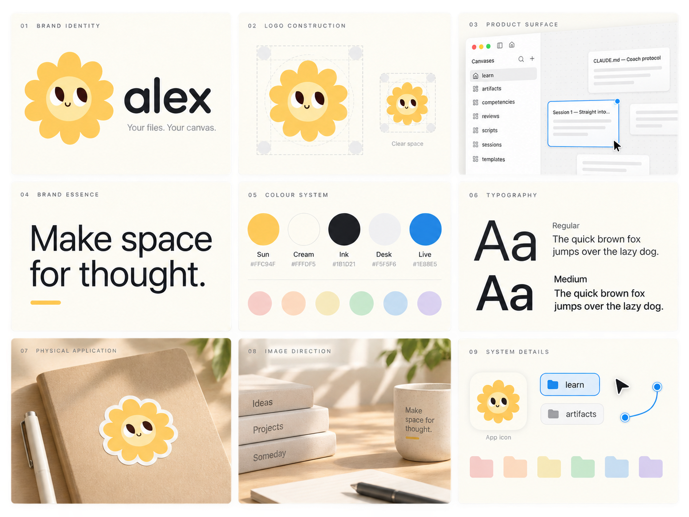

# Alex brand guidelines

Version 1.0 — September 2026

## Brand idea

**A bright companion for thinking in space.**

Alex turns ordinary files into a calm, spatial desk. The brand joins two qualities that are often separated: the warmth of a helpful companion and the integrity of a tool that keeps the user's files tangible, portable, and theirs.

The sunflower mascot is not decoration. It is Alex's presence: curious, attentive, optimistic, and quietly alive. The surrounding system should give that character room to breathe.

## Positioning

Alex is a native macOS canvas over plain files. Folders become sections, notes become cards, and the files remain the source of truth.

### Promise

Your ideas stay tangible, connected, and yours.

### Primary expression

**Make space for thought.**

### Supporting expression

**Your files. Your canvas.**

### Personality

- Warm, never sugary
- Curious, never distracting
- Precise, never clinical
- Capable, never grandiose
- Playful in character; quiet in interface

## Logo system

The canonical mark is the sunflower character in `docs/logo/alex-logo.png`. The shipped icon is `AppIcon.png`.

### Meaning

- The circular face is a calm center: the thought or file itself.
- The petals suggest ideas radiating, branching, and connecting.
- The upward gaze gives Alex curiosity and presence without making the character loud.
- The warm sun form contrasts with the neutral desk and makes the app easy to recognize.

### Primary lockup

Use the mascot to the left of the lowercase wordmark `alex`. The wordmark should feel soft and assured, with rounded geometry and no exaggerated personality competing with the mascot.

### Clear space

Keep at least one eye-width of clear space around the standalone mascot. In a lockup, use that same unit above, below, and outside the combined mark.

### Minimum size

- Standalone mascot: 24 px digital, 8 mm print
- Mascot with wordmark: 96 px wide digital, 28 mm wide print
- Below the minimum, use the shipped app icon rather than simplifying or redrawing the face

### Approved backgrounds

Prefer Cream, white, or Ink. On photographs, place the mark only over a calm area with clear contrast. The mascot should not sit directly on saturated yellow or visually busy imagery.

### Do not

- Redraw the face, change the gaze, or alter the smile
- Change the petal rhythm or proportions
- Put the mascot inside a new badge or holding shape
- Add outlines, hard shadows, facial animation, accessories, or seasonal costumes by default
- Use the mascot as a repeating decorative pattern
- stretch, rotate, crop, or recolor the canonical mark

## Color

The palette separates brand warmth from product state. Yellow belongs to Alex's character and moments of welcome. Blue means something is live, selected, linked, or ready for input.

| Role | Name | Hex | Use |
|---|---|---:|---|
| Brand | Sun | `#FFC94F` | Mascot, welcome moments, small brand accents |
| Canvas | Cream | `#FFFDF5` | Brand backgrounds, stationery, warm editorial surfaces |
| Text | Ink | `#1B1D21` | Primary type and dark brand fields |
| Product ground | Desk | `#F5F5F6` | Canvas and neutral environmental surface |
| Interaction | Live | `#1E88E5` | Selection, links, caret, focus, connected state |
| Support | Muted ink | `#6B7078` | Secondary copy and metadata |
| Structure | Hairline | `#E6E6E8` | Dividers and quiet boundaries only |

### Paper palette

Use the existing paper colors for folders, cards, diagrams, and supportive illustration. They are a product vocabulary, not competing brand colors.

| Red | Orange | Yellow | Green | Blue | Purple |
|---:|---:|---:|---:|---:|---:|
| `#F6C8C2` | `#F7D0B2` | `#F8E8B0` | `#C9EBCF` | `#BED5E3` | `#DDD2F2` |

### Color behavior

- Let neutral space dominate.
- Use Sun once per composition when possible.
- Reserve Live for interaction and links; do not use it as ambient decoration.
- Never place white text on Sun. Use Ink.
- Avoid generic multicolor gradients. Soft tonal shading within the mascot is allowed because it belongs to the canonical artwork.

## Typography

Alex uses the macOS system typeface so the product feels native and the brand remains focused on content.

### Family

- Primary: SF Pro / system sans
- Utility: SF Mono / system monospaced

### Weights

- Regular for reading
- Medium for identification, labels, titles, and controls
- No semibold or bold in brand or product chrome
- No italics in product chrome

### Voice in type

- Sentence case everywhere
- Short headings with generous measure
- Large, quiet statements rather than dense marketing blocks
- Monospace only for file paths, commands, formats, and technical metadata

Recommended marketing scale: 56/60 display, 32/38 title, 20/28 lead, 16/25 body, 13/18 label, 11/16 micro. Product typography remains defined in `Sources/Alex/Views/Style.swift`.

## Layout and graphic language

Alex compositions should feel like a well-kept desk: generous, spatial, tactile, and easy to scan.

- Build on a 4 pt spacing unit, with 8, 12, 16, and 24 pt as the core rhythm.
- Use broad empty areas and a few meaningful objects.
- Treat cards, folder tabs, connecting lines, and the dot grid as the primary graphic vocabulary.
- Keep corners consistent with the product: 4, 6, 8, and 16 pt, plus true capsules.
- Use soft elevation only when an object is genuinely resting above another surface.
- Prefer asymmetry balanced by strong alignment over centered, template-like layouts.

## Imagery

The image world is quiet daylight on tactile working surfaces.

### Use

- Warm, directional morning or late-afternoon light
- Uncoated paper, card stock, notebooks, folders, wood, and matte metal
- Overhead or three-quarter compositions that imply arranging and connecting
- Crops with breathing room for a short line of copy
- Human presence through traces of work rather than posed people

### Avoid

- Generic offices, staged teams, robots, brains, and AI particles
- Glossy 3D plastic or candy-colored scenes
- Excessive mascot placement
- Children's craft aesthetics
- Dark cyberpunk imagery or purple-blue AI glow

## Iconography and UI expression

- Use Lucide only, at the weights already defined in the product.
- Icons support verbs and navigation; they are not decorative brand motifs.
- Blue marks live state, including the tool currently in hand: a blue square under a white glyph. Grey squares mark location. Solid Ink capsules mark the one action a surface asks for.
- A single friendly mascot moment is more effective than many character illustrations.
- Product screenshots should show real files, spacious canvases, and believable work. Avoid fabricated high-density dashboards.

## Motion

Motion should make spatial change legible, not make the brand perform.

- Quick feedback: 120 ms ease-out
- Object movement: 220 ms ease-in-out
- Camera focus: use the product token and settle gently
- Mascot motion, when needed, should be limited to a small gaze shift or calm arrival; never bounce continuously
- Respect Reduce Motion by replacing all transitions with cuts

## Voice

Alex speaks like a calm, observant collaborator.

### Principles

- Say what happened.
- Name the object the user is acting on.
- Prefer concrete verbs over product jargon.
- Keep warmth in the phrasing, not in exclamation marks.
- Never imply that Alex owns, hides, or transforms the user's files into a proprietary system.

### Examples

| Instead of | Prefer |
|---|---|
| Supercharge your knowledge! | Make space for thought. |
| AI-powered second brain | A canvas over your files. |
| Successfully imported 12 assets | Added 12 files to the canvas. |
| An error occurred | “plan.md” changed on disk. Choose which version to keep. |
| Get started now | Choose a folder |

## Brand applications

### App icon

Use the shipped icon unchanged. Keep the warm off-white tile and generous space around the mascot. Do not add labels, notification-like shapes, or extra borders inside the icon.

### Website and launch materials

Lead with one large promise, one honest product surface, and one mascot moment. A useful default sequence is: promise, product truth, spatial use case, local-file principle, download.

### Social and editorial

Favor cropped product canvases, simple card compositions, or tactile paper still lifes. Use the mascot as a signature rather than a presenter in every frame.

### Stickers and print

Use the mascot on Cream or die-cut around the petal silhouette with a white keyline. Keep wordmark stickers typographic and separate.

## Decision filter

Before shipping a brand expression, ask:

1. Does it make files and ideas feel tangible?
2. Is the mascot adding presence rather than noise?
3. Is the page mostly calm neutral space?
4. Is blue reserved for something live?
5. Does the language sound concrete and trustworthy?
6. Would this still feel native beside the product itself?

If the answer to any of these is no, simplify.
