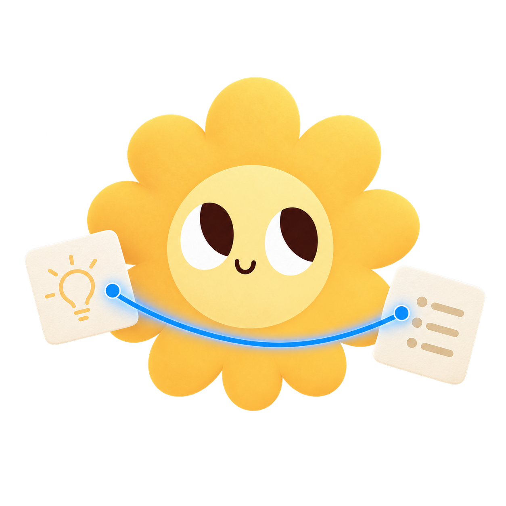

# Alex mascot assets

Six transparent PNG illustrations for product states. Each master is 1254 × 1254 px with an alpha channel and is packaged automatically by the Swift target's existing `Resources` rule.

## Asset set

### Welcome


`alex-welcome.png`

Use for the first launch, vault picker, onboarding completion, or a warm re-entry state. Do not repeat it on routine launches where it would become visual noise.

### Empty canvas


`alex-empty-canvas.png`

Use when a new canvas or folder has no placed content. Pair with one clear action such as “Add a note” or “Drop files here.”

### Connect ideas



`alex-connect-ideas.png`

Use in connection-tool education, onboarding, or an empty relationships view. The blue line already communicates live interaction, so avoid adding another decorative blue accent nearby.

### Search empty


`alex-search-empty.png`

Use only for an unsuccessful search, not before the user enters a query. Suggested copy: “No files match that search.”

### File conflict


`alex-file-conflict.png`

Use beside the existing changed-on-disk choice. Keep the surrounding copy direct and calm; the illustration intentionally avoids warning symbols.

### Door connected


`alex-door-connected.png`

Use when the local MCP door is successfully serving or when setup finishes. Do not use it for disconnected or error states—the blue endpoint specifically means the door is live.

## Product usage

- Display between 120 and 240 pt in ordinary empty states.
- Preserve the square canvas and use `.scaledToFit()`; do not crop the petal silhouette.
- Keep at least 16 pt between the visible artwork and nearby text.
- Put the illustration above the state title when the available width is narrow, or beside it in wide welcome surfaces.
- Do not put these assets inside another card, badge, app-icon tile, or circular mask.
- Show at most one mascot illustration on a surface.
- Use the canonical app icon or logo for identity; these illustrations are narrative product moments, not logo replacements.
- Treat every image as decorative when the adjacent title already describes the state. Otherwise use the alt descriptions shown in this document.

## SwiftUI loading

The files live under `Sources/Alex/Resources/Mascot/` and are included by the package's existing `.process("Resources")` rule.

```swift
Image("alex-empty-canvas", bundle: .module)
    .resizable()
    .scaledToFit()
    .frame(width: 180, height: 180)
    .accessibilityHidden(true)
```

## Character continuity

Alex keeps the same face across the set. Emotion comes from composition, gaze context, and the object being handled—not from exaggerated mouths, brows, costumes, or emoji-like expressions. Future assets should follow the same rule.

## Micro kit

The micro kit lives in `Sources/Alex/Resources/Mascot/Micro/`. These optimized 512 px transparent PNGs are for small, reusable moments around 32–96 pt.

| Asset | Purpose | Good placements |
|---|---|---|
| `alex-mini.png` | Smallest complete character signature | About, welcome copy, release notes, friendly confirmation |
| `alex-peek-edge.png` | Character peeking over a surface | Bottom of popovers, empty cards, onboarding panels |
| `alex-live-dot.png` | Alex plus connected/live state | Door status, connection success, small service banner |
| `petal-spark.png` | Face-free success flourish | Confirmation toast, new-item moment, release highlight |
| `paper-card-stack.png` | Content or notes shorthand | Import, recent files, templates, drag-and-drop education |
| `live-connector.png` | Connection shorthand | Connect tool, relationships, canvas education |
| `folder-tabs.png` | Folder or organization shorthand | Vault picker, grouping, folder help, organization features |

### Micro-kit rules

- Use `alex-mini` no smaller than 40 pt; its eyes and smile need to remain legible.
- Use the object-only pieces when a full mascot would compete with content.
- `petal-spark` can appear at 20–32 pt as a short-lived success accent.
- Keep micro assets out of primary toolbar buttons; Lucide remains the functional icon system.
- Do not combine multiple micro assets into a decorative cluster.
- Avoid placing a mascot illustration and `alex-mini` on the same surface.
- Preserve the transparent padding and use `.scaledToFit()`.
